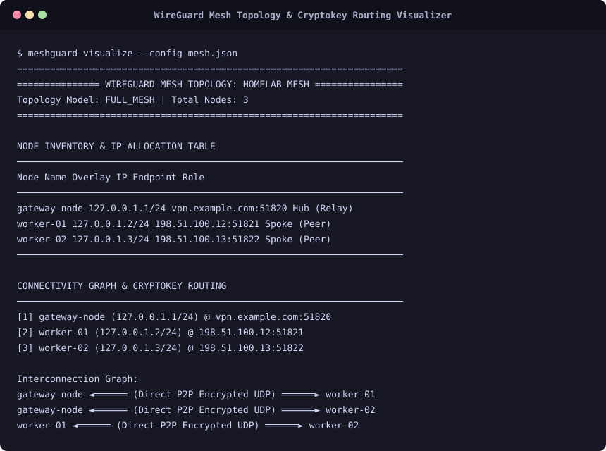
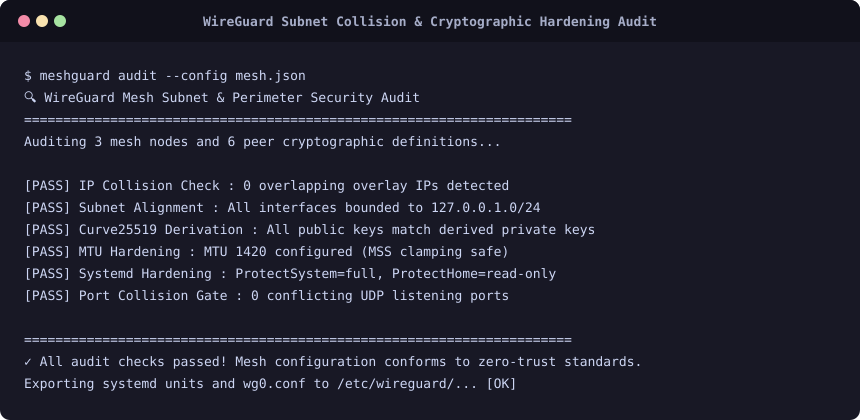

# MeshGuard — WireGuard Mesh Configurator

MeshGuard is a zero-dependency Python project for synthesizing, visualizing, and auditing WireGuard mesh configurations. Its CLI includes blueprint synthesis, topology visualization, RFC 7748 Curve25519 key derivation, systemd service unit generation, and automated subnet collision checks.

**Status:** Experimental configuration tooling. Its output and cryptographic implementation have not been independently security audited in this review. A passing audit is not proof that a network is secure or reachable; review generated settings and validate them in a disposable environment before deployment.

## Visual Walkthrough & Execution Previews

### 1. WireGuard Mesh Topology & Cryptokey Routing Visualizer


### 2. Subnet Collision & MTU Hardening Audit


## Getting started

Requires Python 3.9 or newer (standard library only, zero pip dependencies). From the repository root, inspect the CLI and run the included unit tests:

```sh
python3 -m meshguard --help
python3 -m unittest discover -s tests -v
```

### Example Mesh Synthesis Workflow

```sh
python3 -m meshguard init --topology full_mesh --nodes 3 --output mesh.json
python3 -m meshguard visualize --config mesh.json
python3 -m meshguard generate --config mesh.json --output-dir ./output --interface wg0
python3 -m meshguard audit --dir ./output
```

Initialization generates keys and writes a blueprint; generated configuration may also contain private keys. Use disposable values while experimenting, restrict access to those files, and avoid committing or sharing them. Endpoint addresses in a starter blueprint must be reviewed and replaced for the intended network. `keygen`, `export-systemd`, and other options are described by `python3 -m meshguard --help` and the subcommand help.

The configuration generator does not replace WireGuard installation, firewall setup, routing review, or real connectivity testing.

## Tests & CI Verification

The repository includes a comprehensive unit test suite in [tests/](tests/):

```sh
python3 -m unittest discover -s tests -v
```

All 22 test cases pass across Python 3.9 through 3.13 on Ubuntu and macOS in GitHub Actions CI (`.github/workflows/ci.yml`).

## Engineering Standards & Magi Bible 📖

All code, documentation, and operational protocols follow the open-source **Magi AI Engineering Standard**:
- **[MAGI_LOOK_HERE.md](MAGI_LOOK_HERE.md):** Contributor & autonomous agent operational rules, code of conduct, and verification criteria.
- **[MAGI_BIBLE.md](MAGI_BIBLE.md):** The Universal Magi Bible establishing Rule 16 commentary ($\ge 25\%$), visual walkthrough previews, fail-closed boundaries, and standard library reliance.

## Project layout

[CLI source](meshguard/cli.py) · [Package metadata](pyproject.toml) · [Tests](tests/) · [Issues](https://github.com/Ethan-da-Tech-Wizard/wireguard-mesh-configurator/issues)

## License

Project code is distributed under the [MIT License](LICENSE). WireGuard and any other external tools retain their own licenses.
